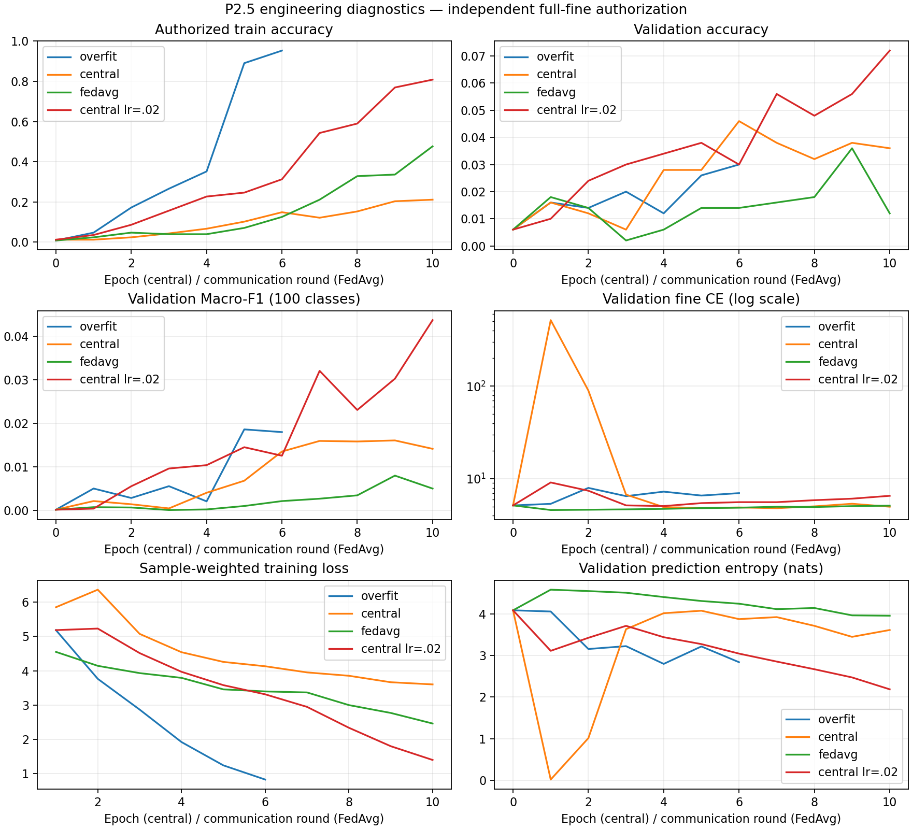

# P2.5：真实训练有效性诊断与 V100 单种子准备

日期：2026-10-12。项目：fed-finelabel-budget。起点：`b5e1904`。

## 1. 结论与范围

- 已定位 P2 的 0% 验证准确率：极短训练导致近乎未学习的预测；主预测类别恰好在原 100 张验证子集中缺失。没有发现 Accuracy/F1 编号或标签映射错误。
- 当前 CIFAR ResNet18 在 128 张真实训练图像上，6 epochs 达到 **95.3125% 训练准确率**，满足 >=95% 的参考目标。
- 独立全 fine 中央学习和全 fine FedAvg 均提高了训练准确率，反向传播、更新、聚合与 checkpoint 有效。小样本验证泛化仍弱，不能据此宣称正式方法有效。
- 发现并诊断了中央 SGD lr=.05 的早期 BN 推理异常；保留原实验，增加仅 lr=.02 的控制实验。V100 的 B0/B1 共同模板据独立诊断采用 lr=.02；未更改已完成的 B0–B4 结果或预算。
- **本阶段没有实际运行 B0/B1 V100 对比，没有运行 B2–B4 GPU 实验，没有启动多种子或 P3。** 已准备 B0→B1 单种子脚本、配置、CUDA 启动检查和曲线工具。

## 2. 环境、数据与访问授权

真实执行环境：`{"python": "3.12.7", "platform": "Windows-11-10.0.26200-SP0", "processor": "Intel64 Family 6 Model 141 Stepping 1, GenuineIntel", "torch": "2.14.1+cpu", "torchvision": "0.29.1+cpu", "numpy": "2.5.4", "pytest": "9.1.1", "cuda_available": false, "training_threads": 2}`。训练使用 CPU 两线程，Python 3.12.7，PyTorch 2.14.1+cpu，torchvision 0.29.1+cpu，numpy 2.5.4，pytest 9.1.1。

物理 GPU 为 NVIDIA GeForce RTX 3050 Laptop GPU / 4096 MiB / driver 566.07（nvidia-smi 实测）。现有 PyTorch CUDA unavailable；未连接 V100。尝试独立 `.venv-p25` CUDA 安装时 2.3 GiB wheel 流式下载失败并重试；官方 range 下载也缓慢/超时，因此中止，不声称安装成功或执行 GPU 训练。所有诊断改用显式受限 CPU 配置；未运行完整 CPU baseline。额外 numpy/yaml/pytest/matplotlib 依赖的 Windows PE sandbox 安装错误，经仅项目环境的提升权限重试解决；该环境没有可用 CUDA Torch。绘图使用现有 Anaconda Python 与 matplotlib。

使用 P2 已下载且验证官方 MD5 的 CIFAR-100，未替换数据。训练/验证继续使用 split seed=20261011：先按公共原始 ID 留出 5000 验证，再从剩余 45000 取前128/256样本。诊断验证只取固定前500张。分区只使用公共 ID；全 fine FedAvg 使用两个 IID 客户端，每个64张，partition seed=101。诊断训练与 5k 验证原始 ID 不相交。

独立诊断 Oracle 的购买上限分别是对应子集全部样本数，逐 ID 明确 query 授权后才构造 ClientDataset；这是用户授权的全 fine 工程诊断，不是正式标注预算实验。`authorization.json` 保存用途、授权数量、配置和原始 ID 清单。训练模块只接收已购快照，不能接收原始 reader、Oracle 或 evaluator。**所有本阶段入口 test_samples=0，未读取官方测试标签，也未根据测试集选择配置。**

## 3. 原 P2 的 0%：逐项核查

### 3.1 验证集与指标

原 P2 实际评估100张，包含64个 fine 类、20个 coarse 类；并非100类各一张。完整 held-out 5000张包含全部100类，每类33–65张。原100张的 fine 类直方图如下（索引0–99）：

`[0, 0, 1, 0, 2, 0, 0, 0, 1, 3, 0, 1, 1, 0, 2, 3, 0, 2, 1, 1, 2, 1, 1, 3, 1, 0, 0, 1, 1, 3, 0, 0, 0, 0, 0, 0, 0, 0, 1, 0, 2, 0, 0, 1, 0, 1, 1, 1, 0, 3, 1, 3, 1, 2, 1, 0, 0, 2, 3, 1, 1, 1, 2, 4, 1, 1, 0, 0, 2, 1, 0, 1, 0, 0, 1, 0, 1, 2, 1, 0, 2, 3, 1, 1, 1, 1, 2, 2, 0, 0, 2, 1, 0, 1, 1, 1, 1, 2, 1, 3]`

原验证子集**没有类别56和42**；类别17有2张，81有3张。模型预测 argmax 返回0–99，真实标签也是0–99。指标 confusion 是100×100，Accuracy 为正确数/N；Macro-F1 固定对全部100类平均，缺失类记零，不使用仅出现类的均值。控制 logits 测试覆盖全部100类：正确高 logit → Accuracy=1、Macro-F1=1；循环错位高 logit → 两项=0。两类子集完全正确 → Accuracy=1、Macro-F1=.02，符合固定100类定义。

下面是在**原验证子集**重载已有最终 checkpoint 的真实结果；五个方法仍均 Accuracy=0、Macro-F1=0，未改变子集以制造非零结果。

| 方法 | fine/coarse 样本使用次数 | 验证 Fine CE | 平均预测熵（nats） | 预测类别:数量 | BN counter |
|---|---:|---:|---:|---|---|
| B0 | 120/0 | 4.608662 | 4.586146 | 56:67, 17:25, 81:8 | [3] |
| B1 | 3/117 | 4.610951 | 4.587261 | 56:96, 42:3, 17:1 | [3] |
| B2 | 4/116 | 4.611886 | 4.586470 | 56:96, 42:3, 17:1 | [3] |
| B3 | 4/116 | 4.612594 | 4.586963 | 56:96, 42:3, 17:1 | [3] |
| B4 | 4/116 | 4.611886 | 4.586470 | 56:96, 42:3, 17:1 | [3] |

均匀100类的 CE/熵为 ln(100)≈4.60517：这些 checkpoint 的预测仍近似均匀，但细小 logits 差异使 argmax 集中。B1–B4 有96张预测为56，3张为42，两类在验证中均缺失；剩余1张预测17也没有命中。B0 有67张预测56，剩余33张预测17或81但没有命中。这解释**观测到的零命中**，不能解释为数学上 Accuracy 永远为零，也不能据此判断 acquisition 策略失败。

每个方法实际只有3个联邦轮次，每客户端每轮1步、batch4：总共30步、120次样本使用。B0 的120次均为fine，B1只有3次fine，B2–B4各4次fine。单客户端 BN counter 只有3。训练 loss 与预测直方图详见 `results/p25_cpu_diagnostic/p2_audit.json`，原逐轮 loss 保留。

### 3.2 层级、模型与损失

- 层级由官方 train 的真实 fine/coarse 配对推导并检查一致性，是20组×5类；例如 coarse0=[4,30,55,72,95]，不是每5个连续fine ID一组。P2 的官方数据校验结果保持有效。
- 当前 ResNet18 的 CIFAR stem 为3×3/stride1，无ImageNet maxpool，最终 Linear输出100。没有在模型末端先做softmax；Fine CE直接接收 logits。
- Coarse marginal = logsumexp(所有100类)−logsumexp(已知coarse组的5类)，在log空间计算。fine已购时只用Fine CE，未购时只用coarse项，没有双算标签。
- uniform logits 的预期 Fine CE=ln100、Coarse loss=ln20；原测试和新增梯度控制通过。每次真实训练 step 检查loss和全部非空梯度有限。隐藏 fine 在训练样本中仍为−1。
- 三种原诊断及低lr控制最终 checkpoint 的 BN 缓冲、整数计数器和参数均原样恢复，授权训练集的完整指标字典相等。

### 3.3 FedAvg 与 BatchNorm

客户端从同一全局模型 deepcopy 后本地更新；浮点参数和BN均值/方差按样本数加权聚合；整数BN counter取最大值。独立人工本地SGD控制测试验证两个客户端的实际更新与手工加权结果一致（权重1/4和3/4）。原P2比较统一使用**公共客户端样本数**作为权重，B0不会改用购买数量来偷偷改变聚合。全fine诊断中公共数=已授权训练数，每个客户端权重1/2。

SGD optimizer每客户端、每轮重新创建；P2原默认momentum=0仍保留，P2.5可显式设momentum=.9但不跨轮保存动量。带动量和显式联合损失配置的轮边界恢复测试也通过。模型 train/eval 切换由 evaluator 恢复；评估不能更新BN状态。

## 4. 真实监督与联邦诊断结果

全部关闭强增强，沿用原训练归一化 `(x/255-.5)/.5`，独立随机初始化init=102。中央训练逐epoch shuffle seed=105+epoch；FedAvg client_sampling=103、training=105并沿用绝对轮次种子。不存在继承过拟合权重的实验。

| 实验 | 训练样本 | epochs/rounds | 训练Acc（初始→最终） | 最终训练Macro-F1 | 最终验证Acc（500张） | 验证Macro-F1 | 验证CE | 耗时（含评估/恢复） |
|---|---:|---:|---|---:|---:|---:|---:|---:|
| Overfit / Adam .001 | 128 | 6 | 0.7812% → 95.3125% | 0.642738 | 3.00% | 0.017948 | 7.016405 | 43.222s |
| Central / SGD .05 | 256 | 10 | 1.1719% → 21.0938% | 0.122777 | 3.60% | 0.014106 | 5.006016 | 97.774s |
| Central control / SGD .02 | 256 | 10 | 1.1719% → 80.8594% | 0.678055 | 7.20% | 0.043686 | 6.564785 | 97.181s |
| FedAvg / SGD .02 | 128 | 10 | 0.7812% → 47.6562% | 0.253137 | 1.20% | 0.004970 | 5.140092 | 63.212s |

- Overfit：Adam lr=.001、batch16，最多40 epochs，只依据授权训练准确率>=95%停止；实际6 epochs/48 steps/768次样本使用。训练fine CE最终0.361873。训练subset只有71类，所以训练Macro-F1不应期待等于训练Accuracy或接近1。**目标达成**。
- Central原诊断：SGD lr=.05/momentum=.9、batch16、固定10 epochs/160 steps/2560次样本使用，最终训练CE=2.999667。没有验证早停。
- Central低lr控制：同样256张、初始化、随机批次、动量和160 steps，只改变lr=.02，最终训练CE=0.674820。保留原配置和原始日志，不能把两次结果混称一次。
- FedAvg全fine：128张、2个IID客户端，各64张；每轮全参与、每客户端4步、batch16，SGD lr=.02/momentum=.9，固定10 rounds/80 steps/1280次使用。样本有放回，不表示1280张不同图像。训练CE=2.578248，局部样本加权loss从4.549963下降至2.462017（精确值见JSON）。最终验证1.2%，过程最高3.6%，**未选取最好checkpoint替换最终结果**。

各实验的 train/validation histograms、entropy、loss、accuracy、固定100类Macro-F1与时间逐步保留在 `history.json`；FedAvg还有每客户端样本使用及聚合权重。所有4个最终checkpoint均验证精确恢复，BN counters分别48、160、160、40。训练学习能力已确认；验证泛化及全规模Non-IID仍未确认。



## 5. 早期异常的 BN 控制

原中央lr=.05第1个epoch的验证CE=515.539867，虽然有限，但不能称为正常平稳训练。重放相同初始化、相同数据与随机批次，比较训练模式和eval模式；随后只在模型clone上用**训练图像**重新估计BN缓存，参数逐个确认未改变。

| lr | conv1更新范数 | train模式训练CE | eval模式训练CE | 原验证CE | 仅训练图像重算BN后验证CE |
|---|---:|---:|---:|---:|---:|
| 0.05 | 2.206697 | 6.194607 | 484.666393 | 515.539867 | 7.136205 |
| 0.02 | 1.039102 | 4.900389 | 8.480027 | 9.142306 | 5.692338 |

同一参数下验证CE从515.54降到7.14，提供直接证据表明**早期BN运行统计与当前参数不匹配**是巨大推理loss的主要来源；较大参数更新会放大这种差异。低lr控制的首epoch验证CE只有9.14，conv1更新更小。BN原实现没有发现丢失buffer/错恢复的代码错误；它在少量本地步和Non-IID下仍是实验风险。

这不是改变正式FedAvg规则的理由。本阶段只保存诊断反事实结果 `bn_audit.json`；**BN重校准没有加入B0–B4，也没有替换中央或FedAvg的最终权重**。lr=.02选择基于独立全fine训练数值诊断；不是根据官方测试集，也不声称低lr的最终验证CE更优（实际其最终验证CE6.56高于lr=.05的5.01，小样本过拟合明显）。

## 6. 联合损失聚合与梯度

原始 `sample_mean`：`[wf*sum(fine CE)+wc*sum(coarse marginal)]/N`，默认wf=wc=1。2% fine时fine项系数约.02，不是Fine/Coarse各自求均值后相加。小batch经常没有fine，会完全缺少fine CE梯度。

新增显式可复现的 `group_mean`：`wf*mean(fine CE)+wc*mean(coarse marginal)`，缺失组贡献零，无隐式权重归一化。权重必须有限且非负，不能同时为零。`reduction=none`仍返回未加权逐样本项。group_mean仅供控制与后续明确配置，没有替换默认值或真实P2结果。

固定seed=112、100个随机logits、2 fine+98 coarse、两项权重1的实际梯度控制：

| 聚合方式 | loss | fine行logits梯度范数 | coarse行logits梯度范数 |
|---|---:|---:|---:|
| sample_mean | 3.199502 | 0.014278 | 0.056991 |
| group_mean | 9.109432 | 0.713911 | 0.058154 |

fine梯度放大约50倍，coarse约100/98倍，均有限。这是**分组logits梯度**的比较，不等于共享模型参数的总梯度一定50倍。不能随意给所有方法换权重以追求数字。本阶段V100模板保留sample_mean、wf=wc=1；B0只计算已购fine CE。

## 7. V100 单种子预实验准备（未执行）

环境脚本使用Python3.10–3.12（推荐3.12）、torch2.5.1/torchvision0.20.1 CUDA12.1官方配对轮子、numpy2.1.3、PyYAML6.0.3、pytest9.0.2、matplotlib3.10.8。安装命令依据[PyTorch官方历史版本说明](https://pytorch.org/get-started/previous-versions/)。脚本检查CUDA可用、编译架构包含sm_70以及GPU运算；运行脚本进一步检查实际设备为V100。

```bash
# 项目根目录；显式在V100执行，本机没有执行以下安装/训练流程
bash scripts/setup_p25_v100.sh
bash scripts/run_p25_v100.sh
```

启动顺序：下载校验 → 全pytest → 16张训练图像独立授权的真实CUDA forward/backward与checkpoint preflight → B0 → B1 → 生成曲线。preflight权重不保存给基线。若任何门槛失败脚本停止，不自动回退CPU。

配置 `configs/p25_v100_b0_b1.yaml`：

- 固定45k训练 / 5k独立验证 / 不读取官方test；10客户端、公开coarse Dirichlet alpha=.3、min500、partition seed101。
- cumulative2%/4%/8%=900/1800/3600；初购seed104相同，B0/B1随后同一配对Random查询；预算Oracle防重复计费和越界。
- 全部种子沿用split20261011/init102/client_sampling103/query104/training105。
- 每阶段30联邦轮、全10客户端、每客户端50步、batch64、SGD lr=.02/momentum=.9；每个方法90轮/45000 steps/2,880,000次样本使用，阶段之间continue，optimizer每轮重置。
- 默认sample_mean和两项权重1；B0只有fine CE、B1余样本coarse marginal。公共样本数聚合权重一致。计算预算相同，fine监督暴露次数会因方法定义不同，日志明确记录。
- 每轮保存验证Accuracy/Macro-F1/CE/entropy/histogram、train loss、预算、实际样本使用、时间、轮数、种子/配置/协议hash。
- B0/B1输出分别为`results/p25_v100_B0`和`results/p25_v100_B1`，避免CSV互相覆盖。CLI恢复每次只指定一种baseline。

```bash
source .venv-p25/bin/activate
python -m fed_finelabel_budget.p2 --config configs/p25_v100_b0_b1.yaml --baseline B0 --output results/p25_v100_B0 --resume results/p25_v100_B0/B0/checkpoint.pt
```

**没有新增B0/B1真实对比数据表**：本地全fine诊断不是B0/B1预算实验；原P2极短pilot也不能作为P2.5的真实GPU结果。V100 90轮是否充分收敛需由预实验学习曲线验证，没有预先保证。

## 8. 测试、真实命令与错误处理

全部原始48测试保持通过；最终**65 passed**。新增17项含参数化情况：正确/错误logits、固定100类F1、梯度稀释比例、缺失监督组及权重、原均值保留、离线评估不改BN/不暴露label、未授权fine拒绝训练、非法损失配置、人工FedAvg SGD更新、CPU诊断限制、诊断checkpoint拒绝进入baseline、显式momentum与损失配置恢复。

真实pytest结果保留：

| 执行 | 结果 | 输出文件 |
|---|---|---|
| 原48项回归 | 48 passed in 15.33s | results/p25_pytest_initial.txt |
| 指标/损失/控制器首轮 | 20 passed in 10.07s | results/p25_pytest_targeted.txt |
| 新增后的全回归 | 63 passed in 16.46s | results/p25_pytest_cpu.txt |
| 指标与人工SGD控制 | 14 passed in 8.22s | results/p25_pytest_controls.txt |
| 完整65项首次回归 | 65 passed in 14.57s | 本表记录（后续最终日志更新） |
| 最终全回归 | 65 passed in 15.74s | results/p25_pytest_final.txt |

```powershell
$p25TestTemp=Join-Path (Get-Location) ('results/pytest-p25-'+[guid]::NewGuid().ToString())
& ./.venv-p1/Scripts/python.exe -m pytest -q --basetemp $p25TestTemp
& ./.venv-p1/Scripts/python.exe -m fed_finelabel_budget.p25 --config configs/p25_cpu_diagnostic.yaml --only audit
& ./.venv-p1/Scripts/python.exe -m fed_finelabel_budget.p25 --config configs/p25_cpu_diagnostic.yaml --only overfit
& ./.venv-p1/Scripts/python.exe -m fed_finelabel_budget.p25 --config configs/p25_cpu_diagnostic.yaml --only central
& ./.venv-p1/Scripts/python.exe -m fed_finelabel_budget.p25 --config configs/p25_cpu_diagnostic.yaml --only fedavg
& ./.venv-p1/Scripts/python.exe -m fed_finelabel_budget.p25 --config configs/p25_cpu_stable_diagnostic.yaml --only central
& ./.venv-p1/Scripts/python.exe -m fed_finelabel_budget.p25 --config configs/p25_cpu_diagnostic.yaml --only bn
$env:PYTHONPATH='src'
& D:/anaconda3/python.exe scripts/plot_p25.py --diagnostics results/p25_cpu_diagnostic --central-control results/p25_cpu_stable_diagnostic --output reports/P2_5_CURVES.png
```

上述测试、诊断与绘图均exit0；真实checkpoint精确恢复均通过。`bash -n`两个V100脚本通过（仅语法，不执行脚本）。最初查错了Git Bash安装路径，随后正确路径启动遇到sandbox对象权限错误，提升权限仅执行语法检查后exit0。`git diff --check`通过。未删除任何目录或批量文件；下载中止的部分文件留在ignored目录。

## 9. 文件变更与证据保留

- `src/fed_finelabel_budget/p25.py`：可信诊断控制器、原P2重评估、独立授权、BN反事实、记录、CPU限制。
- `training/diagnostic.py`：只接受已授权训练数据的中央训练。
- `eval/offline.py`：仅离线使用的分布统计、CE/entropy/histogram，可选输出，不改变原评估默认结果或BN。
- `training/losses.py`、`training/baselines.py`：显式aggregation/权重，默认原方案不变。
- `training/fedavg.py`、`p2.py`：显式可选SGD momentum、损失配置、诊断恢复用途检查、可选逐轮评估诊断。
- `configs/p25_cpu_diagnostic.yaml`、`p25_cpu_stable_diagnostic.yaml`、`p25_local_diagnostic.yaml`、`p25_v100_b0_b1.yaml`：受限CPU、低lr控制、待执行本机CUDA诊断、待执行V100配置。
- `scripts/setup_p25_v100.sh`、`run_p25_v100.sh`、`p25_cuda_preflight.py`、`plot_p25.py`：可显式运行的环境、CUDA检查、B0/B1与科学曲线。
- `tests/test_p25_diagnostics.py`、`tests/test_p2_controller.py`：新增回归测试。
- `README.md`、`.gitignore`、本报告与`P2_5_CURVES.png`：操作说明与可审阅结果。未修改原P2 configs、数据、原查询策略、既有基线默认监督定义或旧结果。

本机原始数据、授权清单、完整日志/JSON、模型和环境仍按原项目约定ignored，全部保留在results/data/.venv目录，没有将真值/大型checkpoint提交Git。报告表与曲线提交Git。运行元数据明确标记起点b5e1904且工作区包含本阶段修改；后续提交不回写伪造运行commit。

证据文件SHA-256：

- `results/p25_cpu_diagnostic/p2_audit.json`: `df709ea8ce1621590ad3e755ad1c5a08edc6aadca7e82314e9185499b18c8640`
- `results/p25_cpu_diagnostic/bn_audit.json`: `ca1af6f3fb5e36df538966a04f262cb028437d455a660b723a5d25bdb03c50de`
- `results/p25_pytest_final.txt`: `1963db634a9360b4902f4646963c56c11681c619a10306183894f7390398cb49`
- `results/p25_cpu_diagnostic/overfit/summary.json`: `892beb21bb73ef73de339cb9448268dd88a0f8bfddebd2b9e486421dbdc7801c`
- `results/p25_cpu_diagnostic/central/summary.json`: `23a9ff5fad395145268faed3718a6fe18baf7111b7cd80032160de910683c411`
- `results/p25_cpu_stable_diagnostic/central/summary.json`: `c3842022376a82c90ca210eb26d889563482156b6fac39eacac3050817765f7a`
- `results/p25_cpu_diagnostic/fedavg/summary.json`: `ed20b79be0a092244fc574646736f28577993732a497a10d006ed73e45551c02`

## 10. 风险与下一步

1. **已具备在V100开展B0/B1单种子学习pilot的工程条件**：模型可拟合、FedAvg可学习、65项测试、数据/预算/恢复隔离与配置均已准备。
2. 尚未具备声称正式多种子baseline有效的实证条件：真实CUDA环境和full45k/coarse Non-IID未跑，预算B0/B1是否学习尚待验证；本次FedAvg是128张IID，不能替代10客户端Non-IID实验。
3. BN在小本地batch及Non-IID下仍可能有train/eval偏差；观察验证CE、预测熵和类别集中度，并保留原始日志。不能偷偷给某个方法重算BN。
4. sample_mean会按预算比例稀释fine CE；这属于明确保留的原监督定义。group_mean/权重只能作为后续显式、可复现配置，不根据官方测试集调整，也不混合不同损失口径的结果。
5. 本阶段三种工程诊断优化器/步数不同，不构成方法公平比较。正式B0/B1模板共享数据/初始化/聚合/计算预算；阶段继续训练、局部动量每轮重置和有放回采样均须在论文实验说明披露。
6. 小诊断集明显过拟合，验证Acc/F1偏低、最终验证CE偏高；CPU与V100固定库版本不同，不保证跨环境位级一致。正式checkpoint恢复应锁定同环境。
7. 下一步应由用户显式在V100运行CUDA preflight和B0→B1单种子pilot，先审阅学习曲线、监督使用次数和BN稳定性，再安排B2–B4；官方测试集仍只用于最后锁定配置后的评估。本阶段到此停止，没有进入P3。
